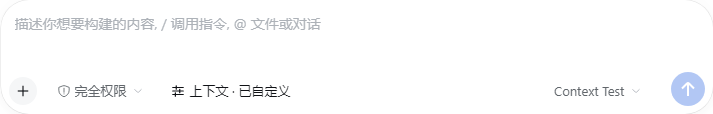
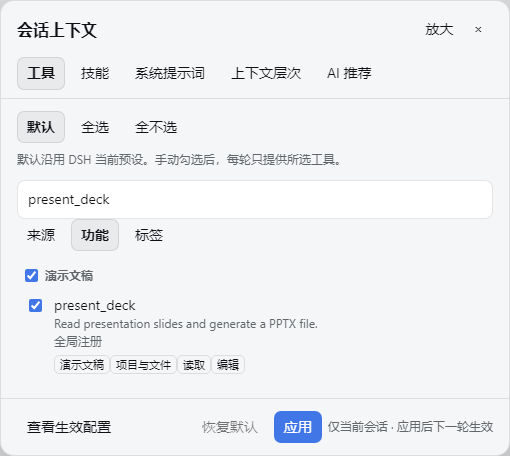
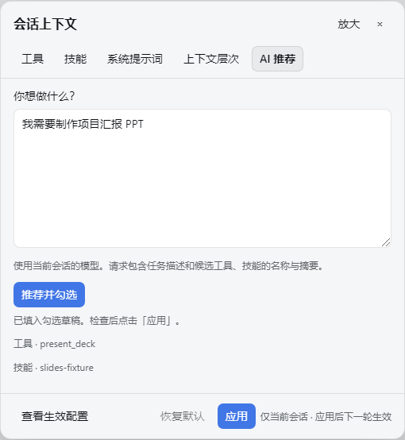
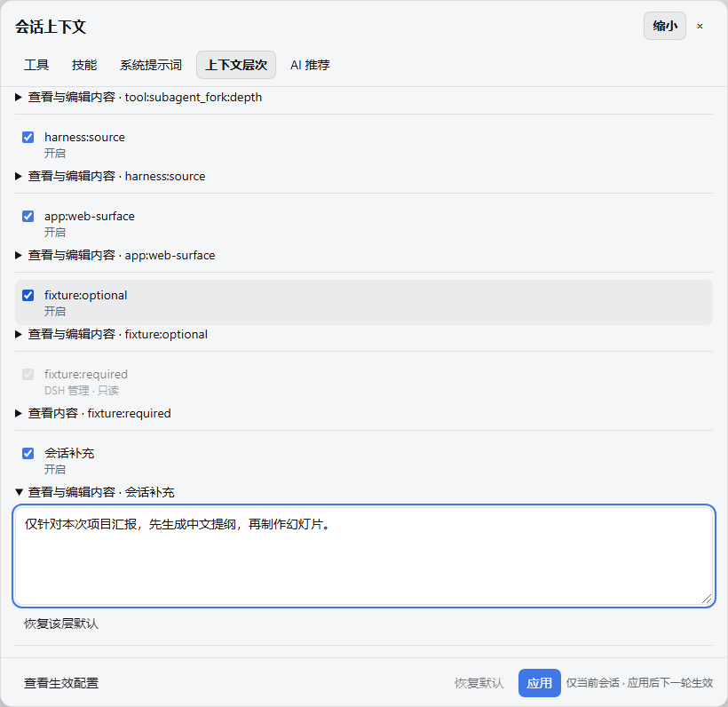

# DSH 会话上下文

DeepSeek Harness 的非官方插件。在对话栏为当前会话选择工具与技能、修改系统提示词及运行上下文，也可以让当前模型推荐配置。

## 安装

本版本适用于 **DSH 0.2.2-rc.3**。

1. 从 [v0.3.0 Release](https://github.com/Makimasdog/dsh-conversation-context/releases/tag/v0.3.0) 下载 `dsh-conversation-context-0.3.0.tgz`。
2. 在 DSH 打开 **插件 → 添加插件**，输入下载文件的绝对路径。Web profile 也可以使用下面的命令。
3. 重启 DSH，打开普通会话，在输入栏点击 **上下文**。

```sh
dsh plugin --profile web add ./dsh-conversation-context-0.3.0.tgz
```

## 使用

在 DeepSeek Harness 的对话输入栏点击 **上下文**。点击 **应用**后，配置从当前会话的下一轮开始生效。点击 **恢复默认**可清除临时配置。



### 工具和技能分类

工具和技能均支持搜索、逐项和按组勾选。可按 **来源**、**功能** 或 **标签** 切换分组。插件根据名称和描述生成标签，同一项可出现在多个标签组。MCP 工具的来源会显示服务器名。



- **工具**。支持全选、全不选和预设默认。手动选择按工具名生效，MCP 重连可以恢复原有勾选，晚注册的新工具保持未选。由会话直接注册的工具通过执行限制控制。
- **技能**。支持 DSH 自动发现或手动选择。手动模式在每轮首步载入选中技能的正文，并停用自动加载入口。插件遵守技能作者的用户调用设置。

### AI 推荐

输入「我需要制作项目汇报 PPT」之类的任务，再点 **推荐并勾选**。当前会话模型会收到任务描述和候选工具、技能的名称与摘要。推荐结果填入勾选草稿，可以手动调整，再点 **应用**。



### 系统提示词与上下文层次

- **系统提示词**。支持追加或替换，保留字面量 `{{…}}`，上限 16,000 个字符。替换保留 PTC 工具绑定说明。Lite 等使用完整 persona 的预设支持替换。
- **上下文层次**。可放大面板，展开查看、启停或编辑可选运行上下文，也可填写 **会话补充**。工作目录和审批等 DSH 必需层只读。
- **查看生效配置**。查看宿主组装的系统提示词、工具声明、执行限制、待注入技能和有效运行上下文层。PTC 模式的 `run_code` 由 DSH 声明，工具选择控制其程序绑定。



配置保存在当前会话的宿主内存，宿主重启后恢复默认。切换预设会清除临时提示词和运行上下文覆盖。已经写入的会话历史继续按 DSH 的规则保留。

## 本地开发

```sh
npm test
npm run build
npm pack
```

构建生成 `dist/client.js`。`npm pack` 生成含浏览器产物的预构建安装包。

## 实现

浏览器通过 DSH 原生 `conversation.input.left` 插槽挂载面板，通过 Typert Remote 读写当前会话。宿主仅接收主端请求，保存前检查 agent 空闲状态和配置版本。工具过滤用 agent scope 的 `tools.restrict()` 和执行 guard。读取工具目录复用已计算的视图，宿主工具视图变化时才重新协调限制。技能正文经 `agent/pre-step` 进入正常上下文历史。系统提示词通过装配钩子调整，完整 persona 预设使用会话作用域覆盖。

## 反馈与许可

提交问题时请注明 DSH 版本、桌面版或 Web、使用的预设和复现步骤。本项目使用 [MIT 许可证](LICENSE)。
